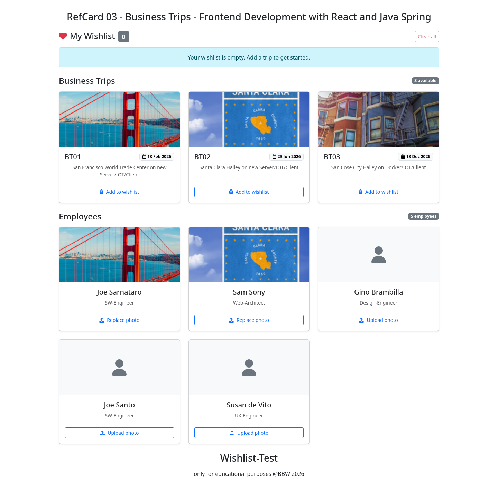

# RefCard 05 – Lokale Entwicklung (Docker Compose)

Startet das gesamte BusinessTrips-System auf dem eigenen Rechner: Frontend, Backend, Datenbank und
Bild-Storage. Dieses Repo enthält keinen Anwendungscode, nur die Compose-Konfiguration.

| Service | Image | Adresse lokal |
| --- | --- | --- |
| Frontend (React + Vite hinter nginx) | aus [refcard-03-fe-react-vite](https://github.com/thelittleerik/refcard-03-fe-react-vite) | <http://localhost:3000> |
| Backend (Spring Boot) | aus [RefCard-03-be-SpringBootBusinessTrips](https://github.com/thelittleerik/RefCard-03-be-SpringBootBusinessTrips) | <http://localhost:8080> |
| Datenbank | `mariadb:10.11` (gleiche Hauptversion wie RDS) | `localhost:3306` |
| Bild-Storage | MinIO (S3-kompatibel) | API `localhost:9000`, Konsole <http://localhost:9001> |

Das Backend läuft lokal mit demselben Spring-Profil (`aws`) und demselben S3-Code wie auf AWS. Nur die
Ziele sind andere: der MariaDB-Container statt RDS, MinIO statt des S3-Buckets.

Teil der Abgabe RefCard 05 von Erik Oros und Sven Toye. Die Gesamtdokumentation steht im
[Backend-Repo](https://github.com/thelittleerik/RefCard-03-be-SpringBootBusinessTrips/blob/main/docs/RefCard05.md).



## Voraussetzungen

- Docker mit Compose v2 (`docker compose version`)
- Alle drei Repos nebeneinander ausgecheckt:

```
<ordner>/
├── RefCard-03-be-SpringBootBusinessTrips/
├── refcard-03-fe-react-vite/
└── refcard-05-compose/          <- dieses Repo
```

## Starten

```bash
cp .env.example .env
docker compose up --build --wait
```

`--wait` kehrt erst zurück, wenn alle Services ihren Healthcheck bestehen. Danach
<http://localhost:3000> öffnen.

Die Startreihenfolge ist über Healthchecks festgelegt, nicht über Wartezeiten:

```
db (healthy) ─────────────────────────┐
minio (healthy) → minio-init (Bucket) ┴→ backend (healthy) → frontend
```

## Prüfen

```bash
docker compose ps                                              # alle Services "healthy"
../RefCard-03-be-SpringBootBusinessTrips/scripts/smoke-test.sh http://localhost:8080
../refcard-03-fe-react-vite/scripts/smoke-test.sh http://localhost:3000 "" http://localhost:8080
```

Die Smoke-Tests sind dieselben, die die Pipelines nach jedem Deployment auf AWS ausführen. Der
Backend-Test lädt ein Foto hoch, lädt es wieder und löscht es – damit sind Datenbank und Storage geprüft.

## Stoppen

```bash
docker compose down        # Container entfernen, Daten bleiben erhalten
docker compose down -v     # zusätzlich Datenbank und hochgeladene Fotos löschen
```

## Konfiguration

Alle Einstellungen stehen in `.env` (Vorlage: [`.env.example`](.env.example)). `.env` wird nicht
eingecheckt. Fehlt die Datei, bricht Compose mit einem Hinweis ab, statt mit leeren Passwörtern zu starten.

| Variable | Standard | Bedeutung |
| --- | --- | --- |
| `FRONTEND_PORT` / `BACKEND_PORT` | `3000` / `8080` | Ports auf dem eigenen Rechner |
| `DB_NAME`, `DB_USERNAME`, `DB_PASSWORD` | siehe Vorlage | Zugang zum lokalen MariaDB-Container |
| `S3_BUCKET`, `S3_ACCESS_KEY`, `S3_SECRET_KEY` | siehe Vorlage | Bucket und Zugang zum lokalen MinIO |
| `BACKEND_CONTEXT`, `FRONTEND_CONTEXT` | `../<repo>` | Pfade zu den beiden Repos |
| `BACKEND_IMAGE`, `FRONTEND_IMAGE` | `biztrips-…:local` | Image-Namen (für Images aus ECR) |

Die Werte in der Vorlage gelten nur für die lokalen Container. Zugangsdaten für AWS gehören nicht in
diese Datei.

Das Frontend darf das Backend nur von `http://localhost:3000`, `:3001` oder `:5173` aus aufrufen (CORS im
Backend). Bei einem anderen `FRONTEND_PORT` bleibt die Seite ohne Daten.

## Images aus ECR statt lokal bauen

Das Backend-Image aus ECR läuft unverändert lokal, da es seine gesamte Konfiguration zur Laufzeit erhält:

```bash
aws ecr get-login-password --region us-east-1 \
  | docker login --username AWS --password-stdin <account-id>.dkr.ecr.us-east-1.amazonaws.com

BACKEND_IMAGE=<account-id>.dkr.ecr.us-east-1.amazonaws.com/biztrips-backend:1.0.0 \
  docker compose up --wait --no-build
```

Das Frontend wird lokal immer gebaut: Vite kompiliert die Backend-URL fest ins JavaScript-Bundle, das
Image aus ECR zeigt deshalb auf den Load Balancer in AWS und nicht auf `localhost`.
